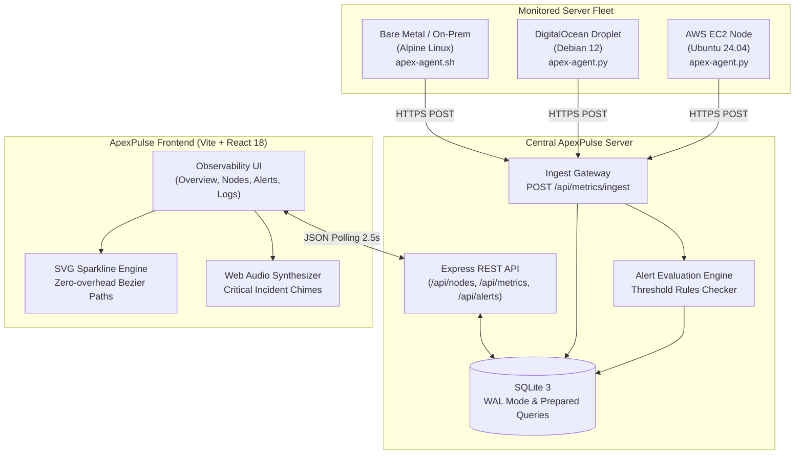

# ApexPulse — Enterprise Cloud & Server Observability Dashboard

[](https://github.com/anesbo/devops-monitor)
[](https://www.typescriptlang.org/)
[](https://react.dev/)
[](https://expressjs.com/)
[](https://www.sqlite.org/)
[](https://tailwindcss.com/)
[](https://www.docker.com/)
[](LICENSE)

**ApexPulse** is a high-performance, real-time cloud infrastructure and server health observability platform. Engineered with a high-end dark observability aesthetic, ApexPulse delivers unified cluster metrics, per-core CPU matrices, container health scoring, automated threshold breach alerting, and interactive incident forensic diagnostics.

Monitors bare-metal servers, AWS EC2 instances, DigitalOcean droplets, and on-premise clusters with **zero external telemetry agent dependencies**.

---

## Architecture Overview



---

## Key Feature Highlights

### 1. Global Fleet Observability & KPI Stat Cards
- Real-time aggregate telemetry KPIs: **Total Nodes** (online, degraded, critical, offline distribution), **Cluster CPU Load %** (peak core utilization, load trend), **Cluster RAM Used** (allocated vs total GB), **Network Bandwidth Throughput** (live RX/TX Mbps breakdown), and **Active Incidents Count**.
- Zero-dependency pure SVG sparklines for CPU, memory, and network throughput with interactive hover crosshairs, min/max point highlights, and gradient area fills.

### 2. Deep Server Node Explorer & Per-Core CPU Matrix
- Dual list and grid view explorer with multi-dimensional filtering (by cluster role: `gateway`, `worker`, `database`, `cache`, `storage`; by health status: `healthy`, `warning`, `critical`, `offline`).
- **`CoreMatrix`**: Interactive per-core heat map visualization supporting up to 128 cores with temperature and frequency indicators.
- **Segmented RAM Allocation**: Visual memory pressure bar (Active Used, Buffers/Cache, Available Free).
- **Container Health Scoring**: Dynamic pod lifecycle scoring formula:
  $$\text{Score} = \max\left(0, \min\left(100, \left(\frac{\text{running}}{\max(1, \text{total})} \times 100\right) - (\text{failed} \times 15)\right)\right)$$

### 3. Proactive Alerting & Incident Command Center
- Configurable multi-metric alert rules (CPU, RAM, Network I/O, Container Health) with threshold comparison operators (`>`, `>=`, `<`, `<=`), duration windows, and instant enable/disable toggles.
- Categorized severity tiers (`CRITICAL`, `WARNING`, `INFO`) and full incident triage lifecycle (`OPEN` $\to$ `INVESTIGATING` $\to$ `RESOLVED`).

### 4. Live Unified Logs & Forensic Incident Drawer
- Live tail streaming terminal with ANSI-styled logs, log level filtering (`ERROR`, `WARN`, `INFO`, `DEBUG`), service filters, and export-to-file capability.
- **Interactive Incident Simulation**: One-click simulation of CPU bursts, memory leaks, container crashes, and DDoS floods for automated testing.
- **Forensic Drawer**: Slide-over incident investigation drawer displaying trigger snapshot values, affected node specs, and recommended operational runbooks.

### 5. Micro-interactions, Sound & Observability Polish
- Deep dark slate/zinc design (`#090d16`), glassmorphism card surfaces, glowing status badges (`animate-ping`), and crisp monospaced telemetry fonts.
- Built-in **Web Audio API alert synthesizer** generates non-intrusive dual-frequency alert chimes for critical incidents with persistent mute toggling.
- Shimmer loading skeletons and clean empty states for all views and tables.

### 6. Production Telemetry Ingestion Agents
- **Python Agent (`agent/apex-agent.py`)**: Zero external dependencies (uses standard library and `/proc` virtual files). Monitors CPU, per-core CPU, RAM, Network I/O, and Docker health.
- **POSIX Bash Agent (`agent/apex-agent.sh`)**: Ultra-lightweight curl-based agent designed for Alpine, embedded systems, and minimal Linux containers.

---

## Tech Stack Breakdown

| Layer | Technologies | Purpose |
|---|---|---|
| **Frontend Core** | React 18, TypeScript 5.7, Vite 6 | High-speed reactive user interface with strict type safety. |
| **Styling & Icons** | Tailwind CSS 3.4, Lucide React | Modern dark observability design system and iconography. |
| **Telemetry Graphics** | Pure SVG Bezier Paths | Zero-overhead responsive sparklines and heat-map grids. |
| **Audio Synthesizer** | Web Audio API (`AudioContext`) | Pure browser-synthesized critical anomaly notification chimes. |
| **Testing** | Vitest, Testing Library, JSDOM | Unit and integration testing across UI components and views. |
| **Backend Server** | Node.js 20/22 LTS, Express 4.21, TypeScript | REST API gateway, telemetry ingestion, and rules evaluation. |
| **Database** | SQLite 3 with Write-Ahead Logging (WAL) | Embedded, zero-maintenance, ACID-compliant persistence. |
| **Node Agents** | Python 3, POSIX Bash (`curl` / `/proc`) | Lightweight background daemons for remote server monitoring. |
| **DevOps** | Docker, Docker Compose, Nginx, Systemd | Turnkey production deployment across cloud VMs and VPS. |

---

## Quickstart Guide

### Prerequisites
- Node.js 18+ or 20 LTS (Recommended)
- npm 9+
- Git

### 1. Local Development Setup
```bash
# Clone the repository
git clone https://github.com/anesbo/devops-monitor.git
cd devops-monitor

# Install root, backend, and frontend dependencies
npm install
npm --prefix server install
npm --prefix client install

# Launch both server (:4000) and client (:5173) in concurrent dev mode
npm run dev
```

Open your browser at **`http://localhost:5173`** to access the dashboard. The backend runs at **`http://localhost:4000`**.

### 2. Running Test Suites
```bash
# Run client unit & view tests (Vitest)
npm run test:client

# Run backend API & calculator tests
npm run test:server

# Run all test suites concurrently
npm test
```

### 3. Production Build
```bash
# Compile TypeScript artifacts for both client and server
npm run build

# Preview production build locally
npm --prefix client run preview
```

---

## Docker Quickstart

ApexPulse includes a production-ready `docker-compose.yml` that provisions the central backend server and static frontend container with a shared persistent volume for the SQLite WAL database.

```bash
# Build and run containers in background
docker compose up -d --build

# Inspect running services
docker compose ps

# View live telemetry server logs
docker compose logs -f server
```

The dashboard will be accessible on port **`80`** (`http://localhost`) and the API gateway on port **`4000`** (`http://localhost:4000`).

---

## Repository Directory Structure

```
ApexPulse/
├── client/                     # Vite + React 18 TypeScript Frontend
│   ├── src/
│   │   ├── components/         # SparklineChart, StatusBadge, IncidentTable, CoreMatrix, AlertModal
│   │   │   ├── layout/         # AppLayout, Header, Sidebar
│   │   │   └── views/          # Primary views (Overview, Nodes, Alerts, Logs)
│   │   ├── views/              # Re-exported views
│   │   ├── pages/              # Re-exported view pages
│   │   ├── context/            # ServerContext (global fleet state & polling)
│   │   ├── services/           # Typed API client layer
│   │   ├── utils/              # soundAlert.ts (Web Audio synthesizer)
│   │   └── __tests__/          # Vitest suites for components and views
│   └── package.json
├── server/                     # Express.js TypeScript Backend
│   ├── src/
│   │   ├── db/                 # SQLite schema, WAL configuration, CRUD helpers, seed data
│   │   ├── routes/             # nodes.ts, metrics.ts, alerts.ts, incidents.ts, system.ts
│   │   ├── services/           # metricsCalculator.ts, simulationService.ts
│   │   └── __tests__/          # Backend integration tests
│   └── package.json
├── agent/                      # Monitored Node Agents
│   ├── apex-agent.py           # Zero-dependency Python 3 Linux daemon
│   ├── apex-agent.sh           # Lightweight POSIX Bash curl agent
│   └── apex-agent.service      # Production systemd unit file
├── docs/                       # Comprehensive Technical Guides
│   ├── REAL_SERVER_GUIDE.md    # Production deployment & remote node handbook
│   └── API_REFERENCE.md        # Full REST API specification & payloads
├── docker-compose.yml          # Multi-container orchestration
├── package.json                # Root orchestration workspace
└── README.md                   # Project documentation
```

---

## Documentation Suite

- **[Production Server Deployment & Node Guide](docs/REAL_SERVER_GUIDE.md)**: Step-by-step handbook for deploying on cloud VMs (Ubuntu 22.04/24.04, Nginx reverse proxy, SSL Let's Encrypt), configuring remote node agents, systemd services, firewall rules, and SQLite WAL backups.
- **[REST API Reference & Contract](docs/API_REFERENCE.md)**: Full endpoint specifications, headers, request/response bodies for `/api/nodes`, `/api/metrics/live`, `/api/metrics/ingest`, `/api/alerts`, and `/api/incidents`.

---

## Target Remote Repository
- **GitHub Repository**: [https://github.com/anesbo/devops-monitor](https://github.com/anesbo/devops-monitor.git)
- **Author & Maintainer**: `anesbo`
- **License**: MIT
